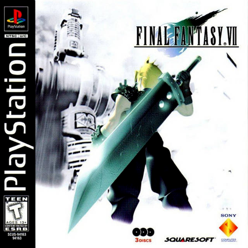

# Final Fantasy 7

<!-- retcomm-readme-metrics -->
[](https://github.com/TechnicallyComputers/Final-Fantasy-VII/releases)
[](https://github.com/TechnicallyComputers/Final-Fantasy-VII/releases/latest)
[](https://github.com/TechnicallyComputers/Final-Fantasy-VII/releases/latest)
<!-- /retcomm-readme-metrics -->

<!-- retcomm-readme-boxart -->
<p align="center">
  
</p>
<!-- /retcomm-readme-boxart -->

Static recompilation of **Final Fantasy 7** built on
[psxrecomp](https://github.com/mstan/psxrecomp) and
[recomp-ui](https://github.com/mstan/recomp-ui).

The Western release of Final Fantasy VII (released as Final Fantasy VII International in Japan) included additional elements and alterations, such as streamlining of the menu and Materia system, reducing the health of enemies, new visual cues to help with navigation across the world map, and additional cutscenes relating to Cloud's past.

| | |
|---|---|
| Players | 1 |
| Region | USA |
| Publisher | Square Enix |
| Year | 1997 |

Scaffolded with the New Project Layout. See
`psxrecomp/docs/GAME_PROJECT_SETUP.md` for the full flow.

<!-- retcomm-readme-launcher -->
## Retro Launcher

You can run this title **standalone** (release zip + the built-in recomp-ui
Generate & Build flow), or manage installs, updates, ROM/BIOS wiring, and queued
builds more intuitively with
**[Retro Launcher](https://github.com/RetroPortingToolKit/Retro-Launcher)** —
the Retro Compilation Manager hub for self-compiling recomps.

[Downloads](https://github.com/RetroPortingToolKit/Retro-Launcher/releases) ·
[Full README & features](https://github.com/RetroPortingToolKit/Retro-Launcher#readme)

<p align="center">
  
</p>

<p align="center">
  
</p>

Retro checks for updates, rebuilds with existing build data when possible,
shares the portable toolchain used by per-title launchers, and automates
BIOS/ROM/save plumbing so you are not stuck repeating each game’s wizard by hand.
<!-- /retcomm-readme-launcher -->

## Symbols and source-level modding

The recompiled C is generated from the disc, so out of the box every function
is named `func_800257CC`. `symbols.toml` and `symbols_overlays.toml` put names
back on ~1,100 of them, imported from the
[ff7-decomp](https://github.com/Xeeynamo/ff7-decomp) symbol map by Xeeynamo and
contributors — see `THIRD_PARTY_ATTRIBUTION.md` for provenance, licence status,
and what may and may not be taken from that project. **Their source is not used
here and must not be merged**; only the address tables were read.

```sh
python3 tools/import_decomp_symbols.py                    # refresh from the pinned commit
python3 tools/import_decomp_symbols.py --verify-generated  # corroborate against our own codegen
python3 tools/sync_symbols.py                             # maps -> psx_symbols.h
python3 tools/sync_symbols.py --check-hooks               # game.toml agrees with the map
```

Host and mod code addresses functions by name — `PSX_FN_SetupGamepad`, not a
hex literal. Setting `hook = true` on an entry makes the recompiler emit a
`psx_mod_function_entry()` call at that function; `src/ff7_mods.c` registers
trusted plugin callbacks against them, and `game.toml`'s address list is
derived from the map rather than hand-maintained.

Imported names are `status = "contextual"` — evidence-backed but **not verified
by us**. The default-off *Hook Trace (developer)* feature in the Mods list is
how you promote one: arm it, do the thing the name claims to describe, and see
whether the call fires.

## Enhancement mods

The [first-release burndown](docs/RELEASE_BURNDOWN.md) records completed checks,
remaining work and the focused validation plan. Gameplay implementation is paused;
the latest authorization covers documentation and tracker updates only.
Loading and visuals take priority; Sephiroth integration follows them.
The [Claude Code handoff](docs/CLAUDE_CODE_HANDOFF.md) contains the owner's
requested continuation for focused validation and the Sephiroth MVP.

Enhancements are independent packages in the Mods screen. All default to off.

**Internal Resolution** (`ff7.enhancement.resolution`) renders polygons at
720p, 1080p (default), 1440p or 4K. It is an integer raster scale (1080p is 5x
at 240 lines), works at the original 4:3 aspect, and does not change saved
renderer settings. `PSX_INTERNAL_RESOLUTION` still overrides it. Prerendered
field backgrounds and FMVs are original-resolution images.

**Enhanced Renderer** (`ff7.enhancement.renderer`) replaces the retired
widescreen feature. It uses psxrecomp's hardware native-wide renderer shared
with Tomba, rather than changing the guest's projection. Options: adaptive
window aspect or fixed 16:9/21:9/32:9, PGXP geometry/texture precision, and
stable texture minification. The primary executable includes PGXP propagation;
activating the mod requests it without changing guest backface decisions.
The world map fills the wide view: its terrain screen cull and sky quad are
widened through `[widescreen.cull]` and `[[widescreen.signed_x_bound]]` in
`game.toml`. Prerendered fields and battles keep 4:3 (fields until a verified
background tile/camera adapter exists; battle ground meshes end inside the
wide margins). FMVs and full-screen 2D use the framework's native policy.

**Fast Loading** (`ff7.enhancement.loading`) adds a guarded host implementation
of the original LZS decompressor. It checks the routine's instruction hash,
decodes into scratch space, and publishes RAM through the runtime's
executable-write tracking. Unsupported input runs the original code. The oracle
compares output and all 32 GPRs against the original MIPS routine on 600
generated streams, two retail assets, and seven streaming-overlap/segment-alias
cases. An optional load speed-up (off by default; 2x, 4x or uncapped) runs
data-loading frames faster and mutes their sound. Native CD timing is retained:
accelerated sector bursts produced incomplete actors in the first battle.

**Expanded Party Research** (`ff7.expanded-party`) has an experimental,
default-off **Added-character gameplay integration** feature (`party-gameplay`).
Sephiroth is its first registered addition. Stable saved identities and separate
guest character records let future additions share assets or rules while owning
their own stats, equipment, materia and progress. Vincent's record and the
original flashback aliases remain native.

Guarded original-code adapters cover PHS selection, equipment compatibility and
inventory transactions, materia exchange, Status, Item and Magic menus,
Wutai materia removal/return, player-controlled battle initialization,
model loading, active/reserve EXP, AP routing and result writeback/display.
Original-MIPS checks on all three owned discs exercise Cloud, Vincent and added
records together. Live diagnostic battles have verified Sephiroth's selected
Attack, Potion and Cure, MP spending, victory and independent EXP/level progress.
These diagnostics place him in a test party; story unlocks/PHS permissions still
follow their original rules.

The field loader prepares a separate script entity and copies his original
skeleton and motions from owned-disc field assets without replacing existing
NPCs. A separate 32-model state arena preserves native entity identities and
delayed actor initialization. Original-code checks on all three discs cover the
11 fields that already use 16 models, plus ordinary and delayed-initialization
fields. Live native battle return and a normal field transition pass. First release
keeps the original story-selected field and world-map avatars. Added-leader
walking/camera is a [deferred enhancement](docs/FIELD_LEADER_ENHANCEMENT.md).
Representative existing story transitions remain acceptance work.
Procedural near-death, death and defend motions use Sephiroth's own paired body
and weapon poses. Live battles verify Defend, low-HP posture, death and Phoenix
Down revival; floor contact, grip and clipping still need visual review. The
first-release scope is two limits, Masamune and Crescent Arc, using his existing
strike/sweep choreography with independent learning and gauge. Live commands
complete single/all-target attacks, consume gauge, update own counters and reach
native victory. The current prototype still defines seven techniques across four
levels; restricting release availability to the two level-1 techniques remains
implementation work. The other five techniques, levels 2-4 and final mastery are
deferred. Learning/unlock, saved progression and representative story compatibility
remain first-release checks; fine balance tuning can follow player feedback.
Keep the feature disabled for ordinary play.

Gameplay saves project extra party handles to a native fallback, preserve native
character records, rebuild the preview/checksum and append per-slot metadata in
the same card file. Loading restores the independent roster after the original
native save load and its checksum comparison. An actual BIOS save, exact standard
export and extended-card title-to-field reload have passed live checks. The
versioned payload also stores the field-party backup bank;
canonical identities survive proxy reordering. Pending writes and roster state
rewind with guest memory. Synthetic lifecycle tests cover sector writes, exact
packet/slot binding, two cards, replacements, reload and rewind.

Export a standard card with an explicit new output path:

```sh
python tools/ff7_save.py export-standard "saves/extended.mcd" --output "saves/standard-copy.mcd"
```

Export preserves the standard base byte for byte and omits extra characters;
it never interprets Sephiroth as Vincent or overwrites the source. See
[the save-format writeup](docs/SEPHIROTH_SAVE_FORMAT.md) for layout, validation,
recovery and native fallback-party policy. Gear and materia held by extra
characters are omitted with those records; exporting does not duplicate them
into the native inventory. The exporter runs as a standalone tool; standard raw
cards load through the existing card path. Standalone save tools satisfy the
release requirement; no recomp-ui export/import integration is required.

The gameplay feature owns card persistence. The earlier `party-save` adapter
remains a test fixture and is no longer offered in the mod catalog, so it cannot
replace the gameplay codec. **Independent record queries** (`party-access`)
provides guarded name and equipment materia-slot access for explicitly published
16-bit extra identities. It allocates separate Expansion 1 records, leaves
ordinary callers and flashback ID 10 stock, and invalidates publication after
savestate restore. Gameplay caller conversion uses the separate registry above.
The calling convention and publication/snapshot API are documented in
`src/ff7_party_access.h`; exact guards and remaining sites are recorded in
`access.evidence.json` beside the package. An original-MIPS oracle checks all
32 registers and the return address behavior of the three query functions.

Read-only evidence tools inspect all three original discs without downloading
decompilation source or distributing assets:

```sh
python tools/inspect_ff7_party.py "disc/Final Fantasy VII (USA) (Disc 1).cue"
python tools/inspect_ff7_animations.py "disc/Final Fantasy VII (USA) (Disc 1).cue"
python -m unittest discover -s tests -p 'test_ff7_animations.py'
ctest --test-dir build-release -R ff7_party --output-on-failure
```

Set `FF7_TEST_CUE` to an owned disc's cue path to include asset-based animation
tests. `inspect_ff7_animations.py --prepare-fallbacks analysis/<directory>`
can prepare local review candidates using Sephiroth's existing motions. They
are never installed automatically and still need battle playback and loader
allocation validation. Instruction evidence lives beside the research package
in `party.evidence.json` and `animation.evidence.json`.

To reproduce the LZS oracle, install Unicorn and build `src/ff7_lzs.c` as a
shared library, then run:

```sh
python tools/test_lzs_against_retail.py --library <shared-library> \
  --disc "disc/Final Fantasy VII (USA) (Disc 1).cue"
```

## Legal

You must own the original game. Disc images under `disc/` are gitignored and
must never be committed. Retail BIOS dumps are not redistributed; OpenBIOS is
used for Generate unless you supply your own SCPH locally.

Default app icon: `assets/psxrecomp.ico` (and `.png` / `.svg`) — Retro-themed controller mark from `psxrecomp/assets/`. Windows builds embed it via `APP_ICON`.

Optional box art under `launcher_assets/img/` may come from
[libretro-thumbnails](https://github.com/libretro-thumbnails/libretro-thumbnails)
(`Named_Boxarts`); see `BOXART_SOURCE.txt` when present.

## Quick start (dev)

```bash
git submodule update --init --recursive
./psxrecomp/tools/ci/build_emitters.sh
python3 psxrecomp/psxrecomp_cli.py generate \
  --config game.toml --project-root . --disc disc/<your>.cue
cmake -S . -B build-release -G Ninja -DCMAKE_BUILD_TYPE=Release
cmake --build build-release --target psx-runtime
```

Zip prefix for CI artifacts: `finalfantasy7`.

## Symbols

Progressive map: `symbols.toml` → `python3 tools/sync_symbols.py` →
`psx_symbols.h` (`PSX_FN_*`). See `psxrecomp/docs/SYMBOLS.md`.

## Framework pins

Submodule gitlinks (`psxrecomp`, optional `recomp-ui`, nested `recomp-net`)
are authoritative. `framework_pins.txt` is an optional scaffold snapshot;
release CI logs SHAs with `record_pins.sh` but builds whatever the gitlinks
resolve to. Bump submodules deliberately — do not float on `main`/`master`
in release CI.

<!-- retcomm-readme-raid -->
---

<p align="center">
  <sub><b>R.A.I.D. — Retro AI Development</b> · a Discord for AI-assisted retro reverse-engineering, decomp &amp; recomp</sub>
</p>

<p align="center">
  <a href="https://discord.gg/Ad9BwSzctP"></a>
</p>
<!-- /retcomm-readme-raid -->
